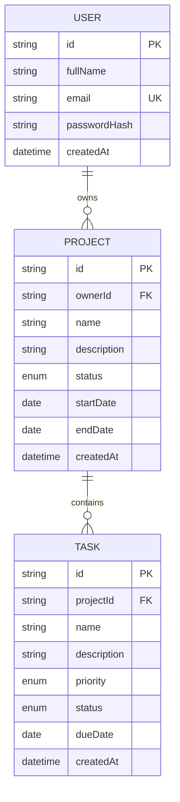

# Waypoint API and data model

Base URL for local development: `http://localhost:4000`. All JSON request bodies use `Content-Type: application/json`. Protected routes require `Authorization: Bearer <JWT>`. Errors use `{ "error": "message" }`.

## Authentication

| Method | Path | Body / query | Success |
|---|---|---|---|
| POST | `/api/auth/register` | `{ fullName, email, password }` | 201 `{ token, user }` |
| POST | `/api/auth/login` | `{ email, password }` | 200 `{ token, user }` |
| POST | `/api/auth/logout` | Bearer token | 200 `{ message }`; token revoked |
| GET | `/api/auth/me` | Bearer token | 200 `{ user }` |

Passwords must be 8-128 characters on registration. Email is trimmed and lowercased. The response user contains `id`, `fullName`, `email`, and `createdAt`; it never contains a password or password hash. JWTs use HS256 and expire in one hour. Auth endpoints are limited to 10 attempts per IP per 15 minutes. On 401, clients should clear the token and return to sign-in.

## Projects

Project statuses: `Not Started`, `In Progress`, `Completed`. Dates are ISO calendar dates (`YYYY-MM-DD`) or `null`.

| Method | Path | Body / query | Success |
|---|---|---|---|
| GET | `/api/projects` | Optional `q`, `status` | 200 `{ projects: [...] }`; includes `_count.tasks` |
| GET | `/api/projects/:id` | — | 200 `{ project }`; includes `tasks` |
| POST | `/api/projects` | `{ name, description?, status?, startDate?, endDate? }` | 201 `{ project }` |
| PUT | `/api/projects/:id` | Any project fields | 200 `{ project }` |
| DELETE | `/api/projects/:id` | — | 204; child tasks cascade-delete |

Names are required and limited to 160 characters; descriptions are limited to 10,000 characters. End date cannot be earlier than start date.

## Tasks

Task statuses: `Pending`, `In Progress`, `Completed`. Priorities: `Low`, `Medium`, `High`.

| Method | Path | Body / query | Success |
|---|---|---|---|
| GET | `/api/tasks` | Optional `q`, `status`, `priority`, `projectId` | 200 `{ tasks: [...] }`; includes project name/id |
| GET | `/api/tasks/:id` | — | 200 `{ task }` |
| POST | `/api/tasks` | `{ projectId, name, description?, priority?, status?, dueDate? }` | 201 `{ task }` |
| PUT | `/api/tasks/:id` | Any of `name`, `description`, `priority`, `status`, `dueDate` | 200 `{ task }` |
| DELETE | `/api/tasks/:id` | — | 204 |

Task names are required and limited to 160 characters. Dates are valid `YYYY-MM-DD` or `null`. A project must belong to the authenticated account.

## Dashboard

`GET /api/dashboard` returns `{ totalProjects, totalTasks, completedTasks, pendingTasks, projectsInProgress }`, scoped to the current user.

## Status/error codes

- `400` invalid input or date/status/priority.
- `401` missing, expired, invalid, or revoked token; invalid credentials.
- `404` resource not found or not owned by this account (same response avoids revealing another user's records).
- `409` email already registered.
- `429` authentication rate limit exceeded.
- `500` generic unexpected server error; sensitive exception detail is logged server-side only.

All create/update/read/delete data access uses Prisma queries. Ownership is checked in query conditions, including tasks through their project's `ownerId`.

## Data model / ER diagram

Prisma schema and initial PostgreSQL migration are in `apps/api/prisma`. The database cascades project deletes to tasks and user deletes to projects.
